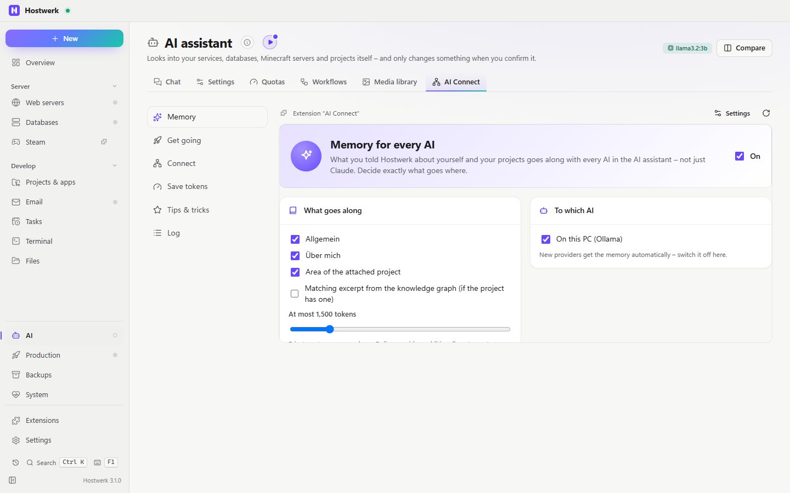

# AI Connect

Connect any AI with Hostwerk – Cursor, VS Code, Windsurf, LM Studio, Claude, Codex, Gemini and any other MCP app: what every AI knows about you and your projects (memory), your AI apps connected to it, get going right in your project, save tokens, tips & tricks.

You find it in the **AI assistant** as the **AI Connect** tab (`#/ki/anbindung`) – its tabs are a list on the left there, like in the settings.

[Deutsch](README.de.md) · An official [Hostwerk](https://github.com/Passimoritz/hostwerk-public) extension. Extension id: `claude` (the name it had at first – kept so updates keep working). The engine stays inside Hostwerk; this extension is its interface plus a small server part for the token limit.



Parts that only work with Claude are marked **for Claude** on the page and below.

## What it does

- **Memory:** what every AI (Claude, OpenAI, Gemini, local …) gets from your thought network – topics, project, graph, size – with a preview per provider.
- **Get going:** pick a project and an AI tool (Claude Code, Codex CLI or Gemini CLI), describe the task (or use a template such as *Fix a bug* or *Write tests*, or your own templates). Hostwerk opens the tool in the project folder and types the command into the Hostwerk terminal. You start it with Enter. Install the tools from the same page, or open claude.ai, ChatGPT or Gemini in the browser.
- **Connect:** pick your AI app and get exactly its way:
  - Claude Desktop: one click (Hostwerk adds itself);
  - Claude Code, Codex CLI and Gemini CLI: their official `mcp add` command in the terminal;
  - Cursor, VS Code (Copilot), Windsurf, LM Studio, Continue: copy the settings in the app’s notation, plus the file path;
  - any other MCP app: the same settings in the common `mcpServers` format;
  - write the context into the instruction file each AI reads (`CLAUDE.md`, `AGENTS.md`, `GEMINI.md`, Copilot, Cursor);
  - open the knowledge graph, or copy the context for claude.ai, ChatGPT or Gemini in the browser.
- **Save tokens** (measuring and saving tools **for Claude Code**):
  - usage per day as a chart, with the trend, and a daily limit;
  - token-saving tools from the online catalog, installed in one click and kept up to date, with pros and cons and a comparison;
  - new projects discovered on GitHub.
  - Usage of every AI in Hostwerk's AI assistant is under AI → Quotas.
- **Tips & tricks:** searchable cards in four categories (keep the context small, good requests, keys & commands, with Hostwerk). Tips that only apply to Claude Code are marked; all others help with any AI. Copy commands with one click.
- **Log:** what a connected AI read and remembered.

## In Hostwerk

- Tab **Get going with AI** in the Projects area
- **Ctrl+Alt+C** (changeable under Settings → General → Shortcuts), the quick search and the “New” menu: *Start an AI in a project*
- Button **Ask an AI with the graph** on the page of the knowledge graph extension
- **Daily token limit for Claude Code** (Settings → Notifications): at 80 % and when it is reached Hostwerk tells you through your notifications – once per day each
- **Own templates** for tasks: saved for everyone who uses this Hostwerk, shared with the team as a short text (*Share templates* / *Paste templates*)

## Install

In Hostwerk: **Extensions → Discover** and click “Install”. Or manually: download the zip from the [latest release](../../releases/latest) → *Extensions → Add → File*.

It runs sandboxed in Hostwerk – it only gets the permissions it lists, and Hostwerk shows them before installing.

## Permissions

The permission names still say `claude` for compatibility; they cover every AI.

| Permission | Why |
|---|---|
| `read:claude` | which AI tools are installed and connected, projects, memory context, tools and usage |
| `change:claude` | write instruction files, install/remove tools (Hostwerk asks first) |
| `run:terminal` | type `claude …`, `codex …`, `gemini …` or an install/connect command into the Hostwerk terminal (you press Enter) |
| `read:knowledge` | number of projects with a graph |
| `connect:claude` | connect/disconnect Claude Desktop (asks first) |
| `storage` | remembers the chosen project, the chosen AI tool and your templates |
| `native` | small server part: checks the daily token limit of Claude Code and sends the notification |
| `extend:extensions` | the button on the knowledge graph page (its author allows it) |

The lists of AI tools, Codex/Gemini CLI connection and `GEMINI.md` need Hostwerk 3.0 or newer; with older versions the page shows the Claude parts only.

## Develop

```
node --test tests/*.test.js
node path/to/sdk/check.js . --strict
```

Logic without a page in `page/lib.js` (tested), server part in `server/`.

## License

MIT
